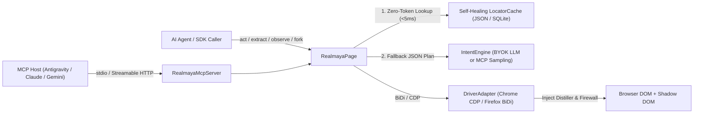

# `realmaya` — Technical Documentation (`DOCUMENTATION.md`)

**Version:** 1.0.0  
**Runtime Compatibility:** Node.js `>=22.0.0`, Bun `>=1.2.0`  
**Engines:** Headless Chrome (CDP) & Headless Firefox (WebDriver BiDi)  
**MCP Protocol:** Model Context Protocol (MCP v1.x) — `stdio` & `Streamable HTTP`

---

## 1. Architecture Overview

`realmaya` is an AI-native headless browser automation engine and MCP v1.x server. Unlike legacy automation frameworks that stream raw HTML (35,000–80,000 tokens per page) or rely on brittle CSS/XPath selectors, `realmaya` injects an ultra-fast (<15 KB) **In-Page Semantic Distiller** that compresses live DOMs (including open Shadow DOMs) into a deterministic, `<untrusted_dom>`-isolated semantic tree in under 30 ms.



---

## 2. Core Modules

| Module | Path | Description |
| :--- | :--- | :--- |
| **Public Entry** | [src/index.ts](file:///c:/realmaya/src/index.ts) | Exports `launch`, `connect`, providers, distiller, firewall, and types. |
| **Domain Contracts** | [src/types.ts](file:///c:/realmaya/src/types.ts) | Strict TypeScript interfaces for `Browser`, `Page`, `SemanticNode`, `DistilledPage`, `LlmProvider`. |
| **BiDi / CDP Transport** | [src/protocol/bidi-client.ts](file:///c:/realmaya/src/protocol/bidi-client.ts) | Multiplexed JSON-RPC over native WebSocket with deterministic timeouts. |
| **Driver Adapters** | [src/protocol/driver-adapter.ts](file:///c:/realmaya/src/protocol/driver-adapter.ts) | Unified `CdpDriverAdapter` (Chrome) and `BidiDriverAdapter` (Firefox) + network capture. |
| **Process Launcher** | [src/protocol/launcher.ts](file:///c:/realmaya/src/protocol/launcher.ts) | Auto-discovers Chrome/Firefox binaries, manages temporary profiles, and cleans up on process exit. |
| **Semantic Distiller** | [src/semantic/distiller.ts](file:///c:/realmaya/src/semantic/distiller.ts) | In-page DOM + Shadow DOM traversal, visibility pruning, `<select>` options, `'full'` content blocks, Set-of-Mark overlay. |
| **Injection Firewall** | [src/semantic/firewall.ts](file:///c:/realmaya/src/semantic/firewall.ts) | Strips zero-width characters, blocks `</untrusted_dom>` delimiter breakouts, filters prompt-injection traps, guards destructive actions. |
| **Locator Cache** | [src/semantic/locator-cache.ts](file:///c:/realmaya/src/semantic/locator-cache.ts) | Exact fingerprint + Jaccard token fuzzy self-healing backed by JSON or `node:sqlite`. |
| **Intent Engine** | [src/ai/intent-engine.ts](file:///c:/realmaya/src/ai/intent-engine.ts) | Orchestrates `click`, `type`, `select`, `press`, `scroll` via cache or `LlmProvider`, enforcing `onDestructiveAction` guards. |
| **MCP Server** | [src/mcp/server.ts](file:///c:/realmaya/src/mcp/server.ts) | Native MCP v1.x server exposing 15 browser & semantic tools with `sampling/createMessage` zero-API-key execution. |

---

## 3. SDK API Reference

### 3.1 Launching or Connecting to a Browser

```ts
import { launch, connect, createOpenAiCompatibleProvider } from 'realmaya';

const llm = createOpenAiCompatibleProvider({
  baseUrl: 'https://api.openai.com/v1',
  apiKey: process.env.OPENAI_API_KEY,
  model: 'gpt-4o-mini',
});

await using browser = await launch({
  engine: 'chrome', // or 'firefox'
  headless: true,
  llm,
  cachePath: './.realmaya/cache.db', // supports .json or .db/.sqlite
  onDestructiveAction: async ({ instruction, action, node }) => {
    console.warn(`Confirm destructive ${action} on "${node?.name}": ${instruction}`);
    return false; // return true to allow, false to block
  },
});

// Or attach to an existing browser WebSocket endpoint:
// await using attached = await connect({ wsUrl: 'ws://127.0.0.1:9222/devtools/browser/...', llm });
```

### 3.2 Semantic Observation, Actions & Structured Extraction

```ts
import { z } from 'zod';

const page = await browser.newPage();
await page.goto('https://example.com');

// 1. Observe interactive tree (or mode: 'full' to include headings & text blocks)
const obs = await page.observe({ mode: 'interactive', maxTokens: 1500 });
console.log(obs.treeText);

// 2. Natural-language actions (click, type, select, press, scroll)
await page.act('click More information');

// 3. Deterministic interactions (by numeric distilled ID or CSS selector)
await page.click(1);
await page.type(2, 'hello@realmaya.dev', { clear: true });
await page.select(3, 'enterprise');
await page.press(2, 'Enter');
await page.scroll({ y: 600 });

// 4. Structured extraction validated by Zod
const summary = await page.extract(
  'Extract the main heading and first paragraph',
  z.object({
    heading: z.string(),
    summary: z.string(),
  }),
);
```

### 3.3 Speculative Parallel Branching (`page.fork()`)

Clone the active page's URL, cookies, `localStorage`, and `sessionStorage` into an isolated browser context:

```ts
await using branchA = await page.fork({ ttlMs: 30_000 });
await using branchB = await page.fork({ ttlMs: 30_000 });

await Promise.all([
  branchA.act('select Standard Shipping'),
  branchB.act('select Express Shipping'),
]);
// Both branches automatically close when exiting the `await using` scope or when TTL expires.
```

### 3.4 Visual Grounding (Set-of-Mark) & Network Mocking

```ts
// Capture a screenshot with numbered [id] bounding-box badges rendered over interactive elements
const base64Png = await page.screenshot({ setOfMark: true });

// Mock fetch / XHR routes deterministically in-page
await page.mockRoute('/api/checkout', {
  status: 200,
  body: { status: 'approved', orderId: 'ORD-991' },
});

// Inspect recorded network exchanges
const exchanges = page.getNetworkLog();
```

---

## 4. MCP v1.x Tools (`realmaya mcp`)

| Tool Name | Description |
| :--- | :--- |
| `browser_launch` | Launch a headless Chrome or Firefox instance. |
| `browser_navigate` | Navigate the active or specified `pageId` to a URL. |
| `browser_observe` | Distill the page into a token-compressed `<untrusted_dom>` semantic tree. |
| `browser_act` | Execute a natural-language action (`click`, `type`, `select`, `press`, `scroll`) via cache or MCP Sampling. |
| `browser_extract` | Extract structured JSON data from the page (`mode: 'full'`) using LLM/MCP Sampling. |
| `browser_click` | Click an element by numeric distilled ID or CSS selector. |
| `browser_type` | Type text into an input/textarea by numeric ID or CSS selector. |
| `browser_select` | Select an `<option>` on a `<select>` element by numeric ID or CSS selector. |
| `browser_press` | Dispatch a keyboard key (`Enter`, `Escape`, `Tab`, etc.) on an element. |
| `browser_scroll` | Scroll the viewport or a specific element into view. |
| `browser_fork` | Speculatively clone the active page into an isolated parallel branch. |
| `browser_list_pages` | List all active pages and speculative `fork()` branches in the session. |
| `browser_screenshot` | Capture a PNG screenshot (supports `setOfMark: true` visual grounding annotations). |
| `browser_purge` | Wipe local self-healing locator caches and session state (GDPR Art. 17 / local privacy compliance). |
| `browser_close` | Close a specific branch/page or shut down the browser. |
