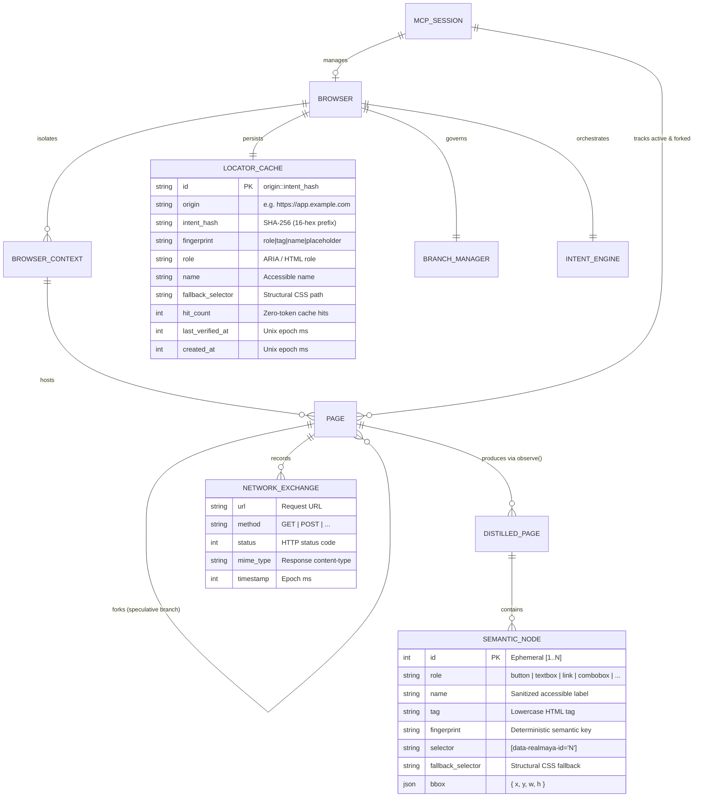
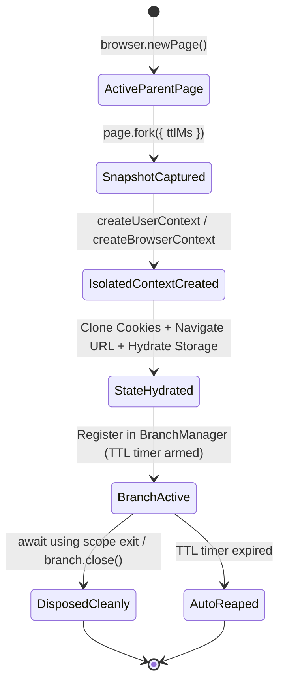

# Entity-Relationship & State Architecture (`ERD.md`)
**Project**: `realmaya`
**Version**: 1.0.0
**Last Updated**: 2026-11-18

---

## 1. Domain Entity-Relationship Diagram



---

## 2. Local SQLite & JSON Persistence Schema (`LocatorCache`)

`realmaya` supports zero-dependency persistence in both JSON (`~/.realmaya/locator-cache.json`) and native SQLite (`~/.realmaya/cache.db` via Node.js `node:sqlite`):

```sql
CREATE TABLE IF NOT EXISTS locator_cache (
  id TEXT PRIMARY KEY,
  origin TEXT NOT NULL,
  intent_hash TEXT NOT NULL,
  fingerprint_json TEXT NOT NULL,
  hit_count INTEGER NOT NULL DEFAULT 1,
  last_verified_at INTEGER NOT NULL,
  created_at INTEGER NOT NULL
);

CREATE INDEX IF NOT EXISTS idx_locator_origin_intent
  ON locator_cache (origin, intent_hash);
```

---

## 3. Speculative Branching (`page.fork()`) State Machine


